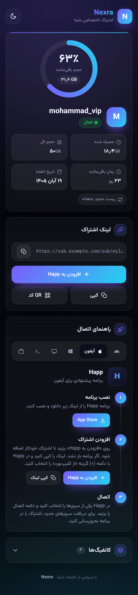
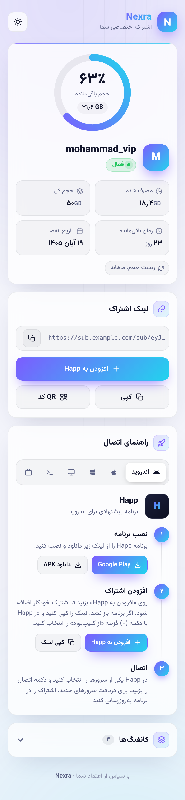
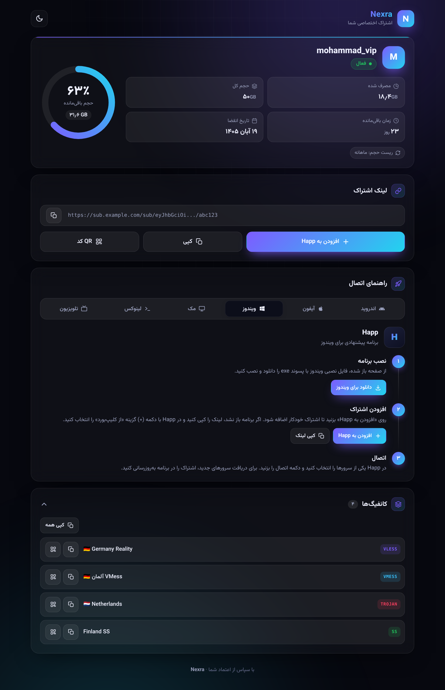

<div dir="rtl">

# Nexra Sub Template

تمپلیت مدرن صفحه اشتراک برای **مرزبان (Marzban)** با طراحی Nexra: تم تیره و روشن، کارت‌های شیشه‌ای و راهنمای اتصال با برنامه **Happ** برای همه دستگاه‌ها.

<p align="center">
  
  &nbsp;
  
</p>
<p align="center">
  
</p>

## ویژگی‌ها

- 🎨 طراحی مدرن با گرادیان بنفش و فیروزه‌ای و کارت‌های شیشه‌ای (Glassmorphism)
- 🌗 تم تیره و روشن، هماهنگ با تنظیمات دستگاه کاربر و قابل تغییر با یک دکمه
- 📊 حلقه حجم باقی‌مانده، مصرف، حجم کل، روزهای باقی‌مانده و تاریخ انقضا به **شمسی**
- 🚦 نمایش وضعیت اشتراک (فعال، در انتظار اتصال، اتمام حجم، منقضی، غیرفعال) همراه با پیام هشدار
- 📱 راهنمای سه‌مرحله‌ای اتصال با **Happ** برای اندروید، آیفون، ویندوز، مک، لینوکس و تلویزیون؛ دستگاه کاربر خودکار تشخیص داده می‌شود
- ➕ دکمه «افزودن به Happ» که اشتراک را مستقیم در برنامه وارد می‌کند (`happ://add/…`)
- 🔗 کپی لینک اشتراک و QR کد (با پس‌زمینه سفید برای اسکن راحت)
- 🧩 لیست کانفیگ‌ها با برچسب پروتکل (VLESS، VMess، Trojan، SS و …)، کپی تکی، کپی همه و QR
- ⚡ سبک و بدون فریم‌ورک؛ فقط فونت وزیرمتن و کتابخانه کوچک QR از CDN بارگذاری می‌شوند
- 🇮🇷 کاملاً فارسی و راست‌چین، با اعداد فارسی

## نصب روی مرزبان

**۱. دانلود تمپلیت روی سرور:**

```bash
sudo mkdir -p /var/lib/marzban/templates/subscription
sudo wget -N -O /var/lib/marzban/templates/subscription/index.html \
  https://raw.githubusercontent.com/MHBehzadian/NexraSubTemplate/main/index.html
```

**۲. معرفی تمپلیت به مرزبان** (اگر این دو خط از قبل در فایل `.env` هست، دوباره اضافه نکنید):

```bash
echo 'CUSTOM_TEMPLATES_DIRECTORY="/var/lib/marzban/templates/"' | sudo tee -a /opt/marzban/.env
echo 'SUBSCRIPTION_PAGE_TEMPLATE="subscription/index.html"' | sudo tee -a /opt/marzban/.env
```

**۳. ری‌استارت مرزبان:**

```bash
marzban restart
```

حالا لینک اشتراک یک کاربر را در مرورگر باز کنید تا صفحه جدید را ببینید.

### به‌روزرسانی

برای دریافت آخرین نسخه، دستور مرحله ۱ را دوباره اجرا کنید و مرزبان را ری‌استارت کنید.

> ⚠️ اگر تمپلیت را شخصی‌سازی کرده‌اید، قبل از به‌روزرسانی از فایل خود نسخه پشتیبان بگیرید؛ دستور `wget` فایل را بازنویسی می‌کند.

## شخصی‌سازی

همه تنظیمات داخل فایل `index.html` است.

**نام برند و متن‌ها** (اول فایل):

```jinja



```

**رنگ‌ها:** در بخش `:root` مقدار `--brand-1` و `--brand-2` را عوض کنید (رنگ‌های گرادیان اصلی).

**لینک‌های دانلود Happ:** در اسکریپت پایین فایل، شیء `HAPP` را ویرایش کنید:

| دستگاه | لینک پیش‌فرض |
| --- | --- |
| اندروید و تلویزیون | [Google Play](https://play.google.com/store/apps/details?id=com.happproxy) و [APK در GitHub](https://github.com/Happ-proxy/happ-android/releases/latest) |
| آیفون و مک | [App Store](https://apps.apple.com/app/happ-proxy-utility/id6504287215) |
| ویندوز، مک و لینوکس | [Happ Desktop در GitHub](https://github.com/Happ-proxy/happ-desktop/releases/latest) |

اگر نسخه‌های Happ را روی سرور یا کانال خودتان هم می‌گذارید (برای کاربرانی که به GitHub یا Google Play دسترسی ندارند)، کافی است همین لینک‌ها را عوض کنید.

## نکات

- فونت [وزیرمتن](https://github.com/rastikerdar/vazirmatn) و کتابخانه [QRious](https://github.com/neocotic/qrious) از `cdn.jsdelivr.net` بارگذاری می‌شوند. اگر CDN در دسترس نباشد، صفحه با فونت سیستم کار می‌کند و فقط QR کد نمایش داده نمی‌شود.
- انتخاب تم کاربر در مرورگر خودش ذخیره می‌شود.
- این تمپلیت برای مرزبان ساخته شده و از متغیرهای `user` همان استفاده می‌کند.

</div>
